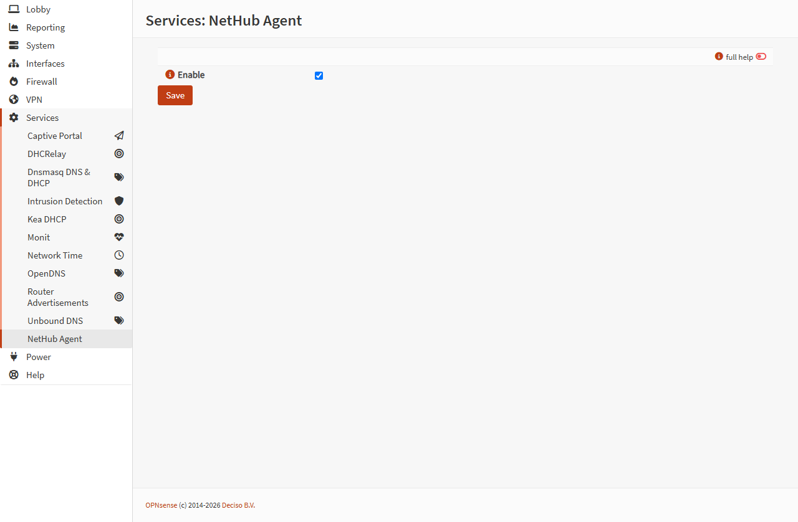

# W1 native validation — 2026-10-18

Validated on the isolated OPNsense 26.7.7 amd64 guest, with pkg 2.8.4,
two vCPUs, and the owner-approved 1 GiB memory exception. A powered-off Hyper-V
checkpoint was created before plugin installation. No signed release package or
packaging-repository change was made.

| Check | Observed result |
| --- | --- |
| Native build | `sh build.sh` produced an unsigned package; `pkg info -F` accepted its metadata. |
| PHP | All four installed PHP source files passed `php -l`. |
| Installation | `pkg add` succeeded, registered the version metadata, ran model migration, cleared menu/ACL caches, and restarted configd. The recorded configd PID changed and status remained running. |
| Menu and form | Services → NetHub Agent appeared. The page had one setting, Enable, initially unchecked. No HTTP or page-script errors were observed. |
| Save | Checking Enable and pressing Save returned `saved`. Reload showed it checked; config.xml contained `OPNsense/NetHubAgent/enabled=1`. |
| API filtering | Get returned only enabled. A write combining enabled with frp_token was rejected and enabled remained 1. |
| Change scope | Other OPNsense models were unchanged. Outside this model, changes were revision metadata and the standard firmware plugin registration. |
| Native model validation | Eleven cases passed using the actual Phalcon model: valid hostname/subdomain and port boundaries; invalid out-of-range ports, dotted/oversized subdomains, quote/newline/carriage-return injection. No test values were persisted. |
| Uninstall | Package and model files disappeared, configd stayed running, menu disappeared, API returned 404, and model settings remained byte-for-byte unchanged. |
| Registration cleanup | Initial testing exposed retained firmware restore registration after direct pkg deletion. The corrected post-deinstall hook calls the stock `register.php remove` operation; retesting verified registration removal without deleting settings. |
| Reinstall | Menu returned and enabled remained 1. Registration was restored, configd stayed running, and `pkg check -s os-nethub-agent` passed. |

The validated corrected development artifact had SHA256
`114a1b896f8d237d554154982f041cea7de8eb10e0c85bbcfb889bc11675c98e`.
Private package logs, raw configuration snapshots, and runtime observations are
stored outside Git. The development package remains installed for W2; it has no
tunnel process, enrollment, template, or autostart service.

The screenshot excludes the host/account header and browser address bar.

CI baseline [39109157063](https://github.com/KazuhaHub/nethub/actions/runs/39109157063)
passed 24 plugin checks. The intentional malformed Menu.xml commit failed
[39109224094](https://github.com/KazuhaHub/nethub/actions/runs/39109224094)
with one XML parse error and 23 passing checks. Restoring the XML passed
[39109328885](https://github.com/KazuhaHub/nethub/actions/runs/39109328885).
The final source revision also includes syntax coverage for the deployment helper.
