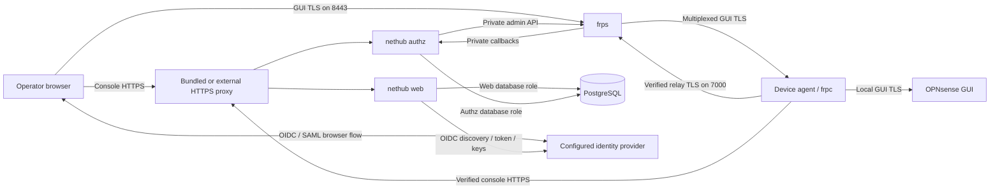

# NetHub threat model

> Implementation review: 2026-10-26. NetHub is pre-alpha, without a signed
> production release. This review reconciles the original 2026-10-16 design
> draft with current sources and accepted records. It is not an independent
> penetration test or a claim that W5-W7 are complete.

The [execution plan](PLAN.md) and [handoff](HANDOFF_PROMPT.md) identify the
remaining gates. The evidence table records the source and environment covered
by each measurement, alongside the remaining unverified assumptions.

## Contents

- [1. Scope](#1-scope)
- [2. System and trust boundaries](#2-system-and-trust-boundaries)
- [3. Assets](#3-assets)
- [4. Attackers and what they can do](#4-attackers-and-what-they-can-do)
- [5. Findings and remaining work](#5-findings-and-remaining-work)
- [6. Accepted risks and known open risks](#6-accepted-risks-and-known-open-risks)
- [7. Out of scope](#7-out-of-scope)
- [8. Evidence and unverified assumptions](#8-evidence-and-unverified-assumptions)

## 1. Scope

The model covers the control plane's Web/authz roles, PostgreSQL, the HTTPS edge,
frps, the OPNsense agent and the flows between them. It includes console
OIDC/SAML, enrollment, source-IP grants, revocation, GUI certificates and relay
trust. External-proxy mode delegates console HTTPS to the existing host proxy.

NetHub has no general device configuration, firewall or command interface. The
agent does change its own native settings and tunnel service. Its bounded GUI
certificate application path can update certificate settings and reload the GUI.
Those privileged paths are part of this model, not an exception hidden behind a
claim that the device never changes.

Only OPNsense has an implemented/tested platform adapter. The shared protocol is
extensible; accepting another platform identifier does not establish its safety
or support. See the [protocol walkthrough](protocol.md).

## 2. System and trust boundaries

The browser's GUI TLS is carried through frps/frpc without relay decryption. The
relay control TLS, console HTTPS and GUI certificate are distinct connections
with separate trust/renewal responsibilities.

| Boundary                               | Current protection                                                                                                     | Limit                                                                                                                                      |
| -------------------------------------- | ---------------------------------------------------------------------------------------------------------------------- | ------------------------------------------------------------------------------------------------------------------------------------------ |
| B1: browser to GUI through 8443        | End-to-end GUI TLS and a NewUserConn source-IP grant.                                                                  | The router still authenticates the user. Existing streams and shared NAT remain relevant.                                                  |
| B2: agent to relay on 7000             | Explicit CA bundle and server name; frp token plus signed assigned-domain claim checked on admission.                  | Endpoint/host compromise can expose bearer material. This is not mTLS.                                                                     |
| B3: device to console HTTPS            | System CA/hostname verification, bounded JSON, no credential-following redirects; one-use enrollment or device bearer. | The configured HTTPS origin and its proxy are trusted.                                                                                     |
| B4: console browser to Web             | Host-only secure session cookies, CSRF/origin checks, strict CSP, password throttling and live account authorization.  | A compromised Web process can issue console sessions and change its served UI.                                                             |
| B5: frps/authz callbacks and admin API | Generated private/loopback publication and exact peer checks; bounded handler work.                                    | Host-network frps and the local host remain trusted. A frozen process is not made responsive by an internal timeout.                       |
| B6: runtime roles to PostgreSQL        | Separate grants, tenant RLS, narrow security-definer operations and device identity-column restrictions.               | Runtime-selected tenant/actor context is not protection from a fully compromised runtime. Database owner/root can bypass these boundaries. |
| B7: console to IdP                     | Authcore protocol validation plus NetHub durable browser/request/replay and account-admission state.                   | The enabled provider's trust configuration and bound identity remain trusted.                                                              |
| B8: plugin UI/configd/native helpers   | Registered actions, bounded validated input, protected temporary files and native configuration locking.               | The agent is privileged on its device; its code/package is part of that device's trust boundary.                                           |
| B9: certificate/trust operations       | Enrollment-bound local GUI key, signed CSR, exact generation checks and protected host authority operations.           | Public application reports are device statements, not independent observations of every later GUI connection.                              |

Docker's generated loopback paths require Engine 28 or newer with the expected
NAT bridge behavior. An external proxy must overwrite incoming forwarding
headers; Web/authz trust only the configured peer. Internal HTTP/database traffic
and local processes rely on the trusted host boundary. See
[deployment operations](deployment.md) and [external proxy configuration](../deploy/external-proxy.md).

## 3. Assets

| Asset                                        | Custody and consequence                                                                                                                                                                   |
| -------------------------------------------- | ----------------------------------------------------------------------------------------------------------------------------------------------------------------------------------------- |
| Router configuration and privileged services | Local device. NetHub's restricted certificate/tunnel paths must not become arbitrary configuration or command execution.                                                                  |
| Assigned hostname and domain claim           | Device identity in PostgreSQL, signed by authz. Compromise of the signer can impersonate routes.                                                                                          |
| Device secret, claim and frp token           | Protected local device state. Device root can read them; the deployment frp token is shared, so it is only one admission layer.                                                           |
| Console passwords, sessions and IdP bindings | PostgreSQL/Web. Compromise permits console administration and phishing, subject to the separate device-signing boundary.                                                                  |
| OIDC secrets and SAML SP signing keys        | Encrypted under Web's key with purpose/tenant/provider binding. Web compromise can decrypt its credential material; authz does not mount that key.                                        |
| GUI private key                              | Created and retained on the device. The control plane receives a public key/CSR, not this private key.                                                                                    |
| Deployment CA and issuer/account state       | Protected operator state outside application runtime containers. Host/root or backup compromise can expose it.                                                                            |
| Enrollment/invitation bearers                | Transit and the recipient's client; stored server-side as digests. The local-password invitation path does not verify mailbox ownership. An admin invitation is therefore high authority. |
| Audit history                                | Append operations serialize per tenant and link hashes. This detects accidental damage, not hostile rewriting by a database owner or truthful behavior by a compromised actor.            |
| Backups and availability                     | Operator-controlled storage and the host. A local secret-copy check does not prove recoverable database state or off-host durability.                                                     |

## 4. Attackers and what they can do

### 4.1 Anyone on the internet

An unauthenticated attacker can reach the public console, enrollment endpoint
and relay listeners. They can attempt passwords and resource exhaustion within
the available network/handler limits. NetHub does not replace OPNsense login
throttling or its own authentication.

Knowing a GUI hostname is insufficient for a new connection while the trusted
relay/authz source gate is enforced. An authorized Open grants the exact
source/device for 30 minutes; another Open renews it, not router traffic or
passive inventory. Public GUI certificates can disclose hostnames through
Certificate Transparency. Random names are not an access-control mechanism.

The gate identifies a network source, not a person. CGNAT peers can share an
allowance. Console and GUI traffic using different IPv4/IPv6 addresses can be
refused. Existing streams may outlive expiry. The phone W0 sample does not close
W5's full mobile console-Open workflow.

### 4.2 An attacker between the browser and relay

This attacker can observe destination addresses and ordinarily visible SNI,
block traffic and attempt redirection. Normal GUI CA/hostname validation prevents
silently substituting a different endpoint. Do not bypass certificate warnings.
Per-device public GUI certificates are in v1 scope and have scoped public/native
acceptance; they are not deferred to v1.1.

A certificate installation receipt is not proof of what a later browser reached.
Keep OPNsense's DNS rebinding and HTTP_REFERER checks enabled and configure the
exact Alternate Hostname. An Open grant is not a substitute for GUI credentials.

### 4.3 An attacker between the device and relay

The agent verifies the relay's assigned TLS server name against its configured
CA bundle. The original no-CA interception attack is not the intended current
configuration. Enrollment first verifies console HTTPS before receiving that
trust; later transitions use authenticated delivery and protected authority
operations. See [F1](#f1-the-devicerelay-control-channel-is-not-authenticated).

A network attacker can still block connections. A compromised trusted relay,
stolen device credentials or compromised authority can act within their own
trust boundary. Captured claims remain bearer material; server authentication
does not turn them into proof of a hardware-bound client or eliminate endpoint
compromise. Modified-client old-stream behavior remains unverified.

### 4.4 A compromised console (`nethub web`)

A fully compromised Web process can manage console users/providers, issue
invitations and enrollment tokens, decrypt its provider credentials, change its
UI, grant source access and revoke devices. It can phish by presenting a different
hostname or label. Client-side projections/CSP help ordinary request/XSS threats;
they cannot make a fully compromised server's UI trustworthy.

The database Web role cannot insert devices or update their assignment, secret
hash or claim fields. It does not hold the domain-claim signing key, relay admin
credentials, deployment CA signing key or device GUI private keys. Issuing a new
enrollment token does not let Web choose an existing device's hostname. These
boundaries rely on the actual role grants, not only API validation.

Enrollment-token INSERT grants exclude caller-chosen expiry; the consume function
also enforces age and active issuer state. A database trigger makes revocation
one-way, including through the Web role. The older draft's arbitrary-expiry and
un-revoke concerns are not left as undecided controls.

This is not complete separation from availability, disclosure or phishing.
Compromise of the deployment owner/host exceeds the Web runtime boundary.

### 4.5 A compromised `nethub authz`

Authz holds the domain signer and relay credentials and can change device records
and admission decisions. It can impersonate routes. The one-way trigger still
blocks clearing an existing row's revoked flag; it does not make a compromised
signing authority safe or prevent abuse of other assignment authority.

Its role/mounts do not expose console users/sessions, OIDC secrets, SAML signing
keys or Web's encryption key. The registered device protocol does not provide a
general router command channel. A compromised service can still deny access,
provide hostile protocol input and attack the privileged agent parser; those
parsers and native application checks are part of the trusted implementation.

Authz is a single point of failure for existing tunnels as well as new admission.
Ping is subscribed in generated configurations. Snapshot refresh, hook errors,
restart and suspended-host behavior have different failure/recovery semantics;
see [availability details](../deploy/revocation-and-heartbeats.md).

### 4.6 A compromised relay or HTTPS proxy

A compromised frps can skip hooks, reroute traffic and read control-channel
claims. It does not normally decrypt the inner browser/GUI TLS, but can cause
redirection, denial or phishing if users accept a forged endpoint.

The HTTPS proxy terminates console/device API TLS. Its compromise exposes
passwords, sessions, enrollment and device bearers crossing that connection.
An external proxy carries the same trust, even though NetHub does not manage its
certificate. Private publication, dropped capabilities and service isolation
reduce exposure; they do not neutralize a compromised trusted endpoint.

### 4.7 A compromised host or database owner

Host root/Docker administration can inspect runtime mounts, change binaries,
read host authority state and bypass container isolation. The PostgreSQL owner
can bypass runtime grants/RLS and rewrite data/history. A hash chain does not
provide forensic integrity against that actor.

There is no ordinary remote configuration API, but a hostile host can manipulate
its issuance and delivery services and attack the agent. The device-local GUI
key/CSR and native validation remain important. Do not generalize their tested
checks into a guarantee that a fully hostile host cannot exploit any native bug.
The operator must protect host access, DNS credentials, issuer state and backups.

### 4.8 A malicious console user

An ordinary member is restricted to owned device rows and permitted account
operations. Tenant RLS does not replace owner/role checks. The checks must use the
current account, not a stale role in a browser view. User disable invalidates
existing sessions and refuses new valid IdP login.

A device can serve attacker-controlled content on its sibling origin. Console
cookies are host-only `__Host-` cookies. Open uses a detached/no-opener tab and no
console referrer. Authz refuses custom-domain and mismatched proxy registrations;
a device is not assigned the console hostname. Keep the console outside the
device suffix and preserve exact proxy/header configuration.

An administrator intentionally has broad console authority. Audit records do not
prevent that administrator acting maliciously or leaking an invitation bearer.
The local-admin guard preserves a count of enabled password administrators, not
an irrevocable account for a particular operator against another administrator.

### 4.9 A compromised identity provider or IdP account

A compromised trusted IdP can authenticate as users already bound to it. For a
bound administrator this grants console authority; the local emergency admin is
an independent recovery path, not a defense against that provider acting as an
already bound user.

OIDC uses verified issuer/subject, state, nonce and PKCE. New invitation admission
requires the exact grant/provider, matching email and signed `email_verified=true`.
SAML uses the trusted IdP and SP-scoped persistent NameID, signed exact-name email
attribute, browser-bound request and durable replay protection. SAML has no OIDC
email-verification flag; accepting signed email is an explicit provider trust.
Neither protocol auto-attaches an existing account by mailbox alone.

The SAML flow cookie is Secure, HttpOnly and SameSite=None for the IdP's cross-site
POST. This does not relax the normal Lax session/OIDC cookies or general API CSRF
policy. The ACS validates its one-use browser/request binding and signed response;
a foreign IdP Origin is not itself an authorization credential.

OIDC outbound traffic is HTTPS, bounded, redirect-refusing and DNS-policy checked.
Private-network exceptions are operator-configured exact authorities, not
wildcards, and do not bypass TLS. SAML metadata is explicitly supplied by the
trusted administrator with XML bounds; it is not an arbitrary metadata URL fetch.
The bounded parser does not authenticate metadata provenance; obtain the document
through a trusted channel before importing it.
These controls do not make a malicious enabled IdP trustworthy.

### 4.10 A stolen or compromised device

Device root can read its local credentials and act as that device. A leaked
shared frp token does not supply another device's valid assigned claim. It still
requires a deployment rotation/recovery procedure; operational rotation is not
implemented merely because its schema exists.

One-way database revocation, combined Ping/Login/NewProxy denial and fresh
connection denial provide observed cutoff for the tested normal clients. The
installed measurement was 17.218 seconds from console confirmation dispatch;
its 374.172-second no-reconnect observation is bounded evidence. It exceeds W0's
2.136-4.958-second probe range, so the PLAN comparison remains open. It is not a
guarantee for modified clients, existing streams or a frozen dependency.

### 4.11 Supply chain

| Component                  | Current control                                                                                             | Remaining boundary                                                                                                                          |
| -------------------------- | ----------------------------------------------------------------------------------------------------------- | ------------------------------------------------------------------------------------------------------------------------------------------- |
| Packaged frpc/relay        | frp 0.71.1 source/dependency locks, selected patched compiler and rebuilt-binary checks/scans.              | Official prebuilt archives are interoperability fixtures, not a fallback packaged client. A pin does not prove an upstream dependency safe. |
| OPNsense package           | Native source/build identity and unsigned development-package acceptance.                                   | Formal recipe, signing, release and faulty-version/canary gates remain separate.                                                            |
| Go/npm and shared authcore | go.sum/lockfiles, direct authcore commit pin, required vulnerability and integration checks.                | The development authcore pseudo-version is not a new formal tag or attestation.                                                             |
| Container images           | Pinned base digests, reviewed local builds and exact CI image archive/configuration/rootfs/platform checks. | Formal published-release provenance and upgrade policy remain open; CI image export is not a signed release.                                |
| Credentials in repository  | Full fetched-history scan and ten exception controls.                                                       | Automated pattern checks do not replace D12's manual disclosure review or prove absence of every operational detail.                        |

Kazuha explicitly permits NetHub use and packaging/signing on the designated test
host (revised DESIGN decision #20). Signing material present there shares that
host's compromise boundary. This does not authorize formal release or extend the
exception to other signing hosts.

### 4.12 Deployer mistakes and recovery

| Mistake                                                 | Consequence and current boundary                                                                                                                                                  |
| ------------------------------------------------------- | --------------------------------------------------------------------------------------------------------------------------------------------------------------------------------- |
| Losing Web's secret key or authority state              | Stored provider material or trust operations can become unrecoverable. Init/doctor verify a protected local copy; they do not prove off-host durability or a restorable database. |
| Trusting forged forwarding headers                      | Source gates/throttles can be bypassed and audit IPs falsified. Configure the exact trusted proxy peer and overwrite client-supplied headers.                                     |
| Publishing internal listeners                           | Exposes privileged APIs/database traffic. Use the generated private/loopback paths; doctor does not prove public/internal reachability.                                           |
| Accepting GUI TLS warnings or disabling hostname checks | Enables redirection/phishing and weakens OPNsense defenses. Use normal certificate validation and exact Alternate Hostnames.                                                      |
| Restarting authz without another management path        | Drops tunnels through the subscribed Ping dependency. Preserve independent host/router access.                                                                                    |
| Treating fresh init as an upgrade/restore               | Can separate existing data from its keys/authority. Preserve original state and use reviewed operation-specific recovery.                                                         |

## 5. Findings and remaining work

### F1. Original relay TLS gap addressed; trust lifecycle remains sensitive

The original draft analyzed frpc without a CA file, accepting arbitrary server
certificates. The current agent renders explicit trustedCaFile/serverName and
verifies initial console HTTPS. Generated deployments keep the CA signing key
outside application runtime mounts. Native initial trust, overlap/recovery and
public certificate records are linked from the handoff.

Retain protected publication, overlap/retirement barriers, validity and offline
recovery requirements. Do not replace trust with a blind CA-file copy or claim
that normal enrollment proves every future recovery path. Claims remain bearer
credentials. Modified-client behavior and complete production release acceptance
are not established by the TLS fix.

### F2. Release provenance and operator workflows remain open

Pinned builds and CI content verification now exist. Formal signed distribution,
release provenance, supported upgrade, faulty-version/canary behavior and the
friend-from-zero deployment remain W7 gates. An exported CI image archive cannot
be substituted for that release process.

### F3. Revocation timing and public/mobile coverage remain open

The stock/native measurements prove cutoff in their recorded cases. The W5
product sample is slower than the W0 probe range. Mobile console Open,
company/campus filtering and broader dual-stack/modified-client coverage remain
unmeasured or incomplete. Preserve the actual limits rather than declaring all
networks or a universal deadline covered.

### F4. Complete restore, operational rotation and doctor coverage remain open

Scheduled database backups/retention, protected off-host durability and a full
clean-host restore with an existing device reconnecting have not passed W7.
The rotate wire shapes do not expose a working HTTP/agent/UI operation. Doctor's
file mode checks initialization/secret/backup/relay material and optional DNS.
Its separate [audit mode](../deploy/audit-chain.md) verifies linked snapshots;
runtime reachability, scheduled-backup and complete restore checks remain open.

## 6. Accepted risks and known open risks

- Local device root can read its credentials; shared NAT/source grants identify
  network position rather than a person.
- The host, authz, relay and edge are availability/trust dependencies. Authz Ping
  adoption extends that dependency to existing tunnels.
- A compromised console can administer accounts, disclose metadata, revoke and
  phish; runtime signer separation does not protect the integrity of its UI.
- A compromised configured IdP can act as its bound accounts.
- Public certificates can disclose GUI hostnames. The router still needs its own
  authentication; NetHub does not enforce OPNsense TOTP.
- Login/SSO throttles are in process; restart or another Web instance changes that
  boundary. v1 assumes one Web instance and one tenant per deployment.
- Online means recent tunnel observation, not GUI health or current certificate
  validity. Router-local failures can still prevent management.
- Development/native evidence includes the owner-approved 1 GiB appliance
  deviation. It does not establish general capacity or latency.
- The authorized packaging-host exception retains its signing-material risk.

The open findings above are not silently accepted as completed features.

## 7. Out of scope

NetHub does not repair independent vulnerabilities in OPNsense, frp, PostgreSQL,
the proxy or the host OS. Its integration must still avoid exposing them more
than necessary and maintain dependency checks. Hostile co-tenants, workstation
or backup compromise, physical host attacks and volumetric denial of service are
not solved by this single-host v1 model.

## 8. Evidence and unverified assumptions

| Claim or assumption                                                   | Evidence and limit                                                                                                                                                                                                                                                                                                                       |
| --------------------------------------------------------------------- | ---------------------------------------------------------------------------------------------------------------------------------------------------------------------------------------------------------------------------------------------------------------------------------------------------------------------------------------- |
| Hook identity, source address and failure behavior                    | [W0 report](../weekend0/results-2026-10-17.md). Backend hang produced stale observations/recovery flapping; this does not establish an unconditional deadline.                                                                                                                                                                           |
| One-way revoke, token expiry and runtime privileges                   | [Core grants/triggers](../server/internal/store/migrations/00001_core.sql), actual-role PostgreSQL tests and current required CI. Owner/root bypass remains outside the runtime-role claim.                                                                                                                                              |
| Audit serialization/hash links                                        | [append_audit](../server/internal/store/migrations/00002_scoped_operations.sql) locks the tenant row across writers. The [read-only checker](../deploy/audit-chain.md) and [version 2 encoding](../server/internal/store/migrations/00026_audit_hash_encoding.sql) retain the non-forensic scope; exact-head SQL acceptance is separate. |
| GUI issuance and native/public application                            | [Native public certificate record](../deploy/validation-native-public-certificate.md), with its exact images, device package and cleanup limits.                                                                                                                                                                                         |
| Relay trust transition/recovery                                       | [Authority operations](../deploy/relay-authority-operations.md) and the handoff's accepted runtime records; not a promise that arbitrary stale backups or expired originals can recover.                                                                                                                                                 |
| Real native cutoff and recovery                                       | [Installed heartbeat/Revoke](../deploy/validation-native-w5-heartbeat.md), including the slower bound and missing mobile sample.                                                                                                                                                                                                         |
| Two actual OIDC issuers                                               | [Two-Dex deployment](../deploy/validation-two-dex.md). Public-provider acceptance is separate.                                                                                                                                                                                                                                           |
| Actual signed SAML vendor                                             | [Keycloak deployment](../deploy/validation-keycloak-saml.md). Fixture inventory is not agent/tunnel evidence; no assertion-encryption or public/mobile claim.                                                                                                                                                                            |
| Device-local client attribution, hostile streams and broader networks | Do not infer complete GUI lockout/logging behavior or malicious-client cutoff from normal browser samples. These remain unverified where no direct measurement exists.                                                                                                                                                                   |
| Operational release/restore/disclosure                                | W7 and owner gates remain open. Repository publication does not by itself complete D12 or authorize history rewriting.                                                                                                                                                                                                                   |
