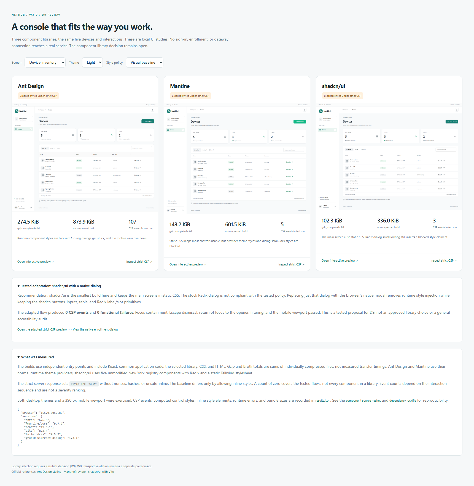
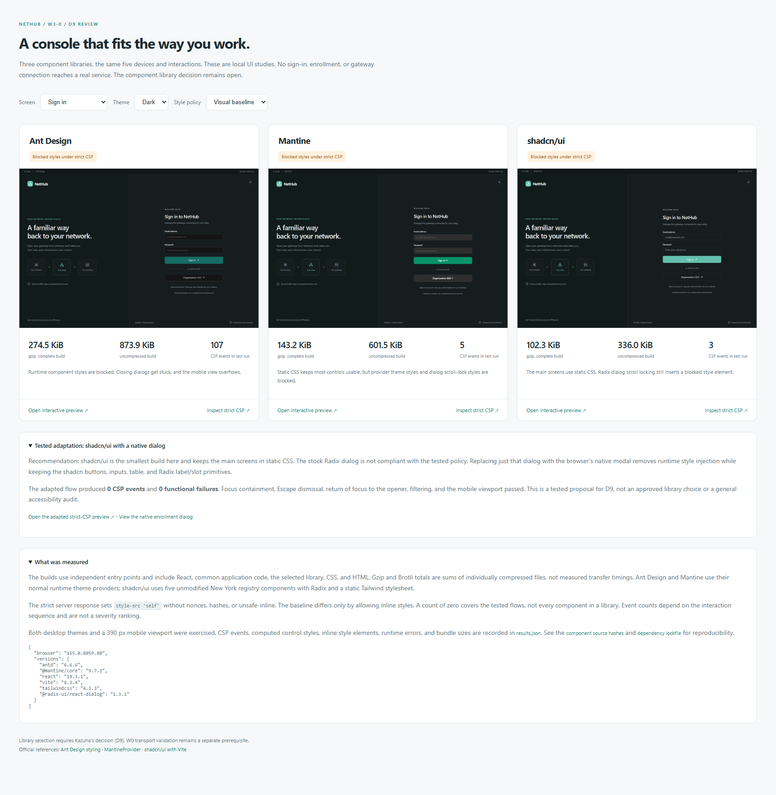

# Console component library study

W3-0 compares Ant Design, Mantine, and shadcn/ui using the same sign-in screen, five sample devices, filters, device details, and enrollment preview. The sample application stays outside the product repository. Kazuha confirmed shadcn/ui with native dialog for D9 on 2026-10-17.

## Results

| Integration | Complete build, gzip | Strict CSP events | Functional failures under strict CSP |
|---|---:|---:|---|
| Ant Design 6.6.6 | 274.5 KiB | 107 | Closing dialogs remain visible; the mobile page overflows |
| Mantine 9.7.2 | 143.2 KiB | 5 | None in the exercised flows; theme and dialog styles are blocked |
| shadcn/ui, stock Radix dialog | 102.3 KiB | 3 | None in the exercised flows; dialog scroll-lock styles are blocked |
| shadcn/ui, native dialog adaptation | Same build | 0 | None in the exercised flows |

All three baseline integrations passed the interaction checks without CSP violations when inline styles were allowed. None of the three default integrations passed the strict policy without blocked style elements.

The additional shadcn variant replaces only its modal with native HTML `dialog`. It retains the shadcn controls and Radix label/slot primitives. Initial modal focus, eight Tab and eight Shift+Tab steps without entering the inert background page, Escape dismissal, focus return to the opener, filtering, enrollment preview, and the 390 px mobile viewport passed under the strict policy.

D9 decision: use shadcn/ui with the tested native dialog adapter. It has the smallest build in this sample and the narrowest demonstrated change needed to meet the style policy. Product integration belongs to W3, after the W0 prerequisites are satisfied.

## Method and limits

- Production Vite builds, separate entry points, one dependency lockfile, and the same shared application code.
- Strict response: `style-src 'self'`, without nonces, hashes, or `unsafe-inline`. The baseline differs only by permitting inline styles.
- Desktop light/dark screenshots, enrollment dialogs, and a 390 px mobile viewport.
- Five interaction groups per integration: sample sign-in, status/details, search/reset, enrollment preview, and online-access feedback. Native dialog focus behavior was checked separately.
- Only local static GET requests were observed, and the sample password was not persisted. No real device, account, token, or identity provider was used.
- Chrome 155.0.8059.80 on Windows; no claim of cross-browser compatibility or a complete accessibility audit.
- Gzip figures sum individually compressed HTML, JS, and CSS files using Node's default gzip settings. They are build comparisons, not measured transfer times or final production budgets. The shadcn build includes both stock and adapted dialogs.
- CSP event counts depend on the interaction sequence. Ant Design required page reloads after stuck dialogs, so counts are diagnostic observations, not a severity ranking.

The report, sources, lockfile, original registry responses, and full-size screenshots are retained in the local `nethub-ui-study` project outside this repository. Run `npm ci`, `npm run build`, `npm run verify`, and `node tools/report.mjs` there to reproduce the study. Five shadcn New York registry components are unmodified and retain their upstream MIT license in that project.

Raw measurements: [results.json](results.json). Dependency versions: [versions.json](versions.json).

## Upstream references

- [Ant Design style compatibility](https://ant.design/docs/react/compatible-style/)
- [MantineProvider and generated CSS variables](https://mantine.dev/theming/mantine-provider/)
- [shadcn/ui Vite setup](https://ui.shadcn.com/docs/installation/vite)
- [shadcn/ui source registry](https://ui.shadcn.com/r/styles/new-york/dialog.json)
